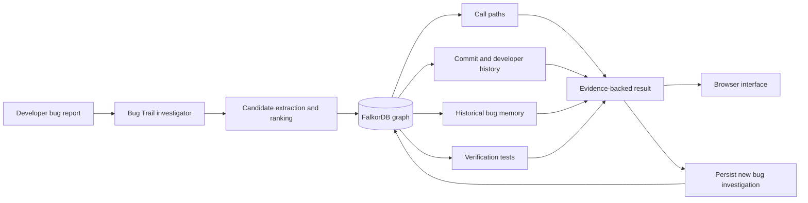

# Bug Trail architecture

## System flow

## Why FalkorDB is central

Bug Trail does not use FalkorDB as a visualization cache. FalkorDB performs the core connected-data work:

1. It follows multi-hop `CALLS` relationships through the codebase.
2. It connects functions to the commits that changed them.
3. It connects commits to developers.
4. It recalls historical bugs and their fixes.
5. It connects fixes to verification tests.
6. It stores each new investigation for future sessions.

## Runtime components

| Component | Responsibility |
|---|---|
| `sample_app/` | Small synthetic shopping codebase used in the demo |
| `scripts/load_codebase.py` | Parses Python AST and loads functions/calls into FalkorDB |
| `scripts/seed_graph.py` | Loads synthetic commit, bug, fix, developer, and test history |
| `app/investigator.py` | Ranks candidates and runs evidence queries |
| `app/graph.py` | FalkorDB connection wrapper |
| `app/main.py` | FastAPI API and static app entrypoint |
| `web/index.html` | Investigation interface and evidence visualization |

